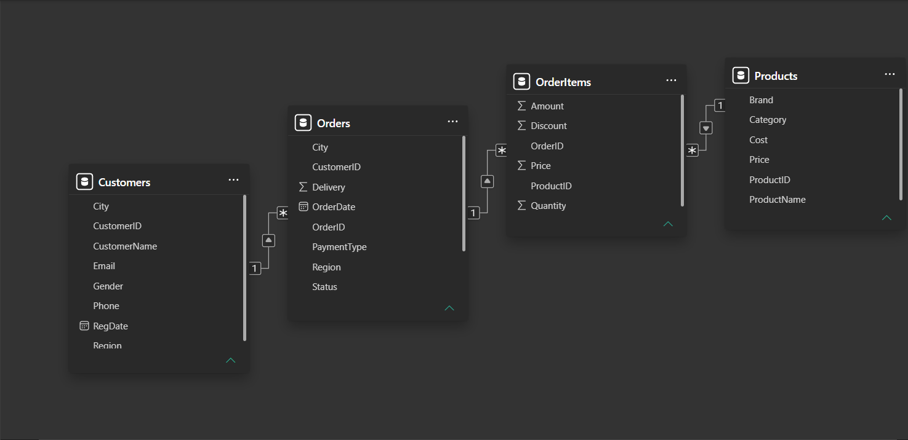

# Дашборд продаж TechnoMarket 2024–2025

Интерактивный дашборд в Power BI для анализа продаж магазина электроники TechnoMarket (Узбекистан). Данные хранятся в MS SQL Server, отчёт подключён к базе напрямую.


## Задача

Дать руководству магазина одну страницу, на которой видно:

1. Сколько выручки принёс магазин и как она менялась по месяцам.
2. Какие категории товаров приносят больше всего денег.
3. Кто ключевые клиенты.
4. Какой средний чек и чем отличаются регионы.
5. Как всё это меняется при фильтрации по периоду и категории.

## Данные

База `TechnoMarket` в MS SQL Server, 4 таблицы:

| Таблица | Строк | Содержание |
|---|---|---|
| Customers | 118 | Клиенты: имя, город, регион, контакты |
| Products | 57 | Товары: категория, бренд, цена, себестоимость |
| Orders | 600 | Заказы: дата, статус, регион, способ оплаты |
| OrderItems | 799 | Строки заказов: количество, цена, скидка, сумма |

Период: 01.01.2024 – 28.09.2025. В расчёт KPI идут только заказы со статусом «Доставлен».

## Модель данных



Схема «звезда»: Customers → Orders → OrderItems ← Products, связи «один ко многим».

## Инструменты

- MS SQL Server и SSMS: загрузка базы, проверочные запросы
- Power BI Desktop: модель, визуализация
- DAX: меры `Выручка`, `Кол-во заказов`, `Средний чек`

```DAX
Выручка = CALCULATE(SUM(OrderItems[Amount]), Orders[Status] = "Доставлен")
Кол-во заказов = CALCULATE(DISTINCTCOUNT(OrderItems[OrderID]), Orders[Status] = "Доставлен")
Средний чек = DIVIDE([Выручка], [Кол-во заказов])
```

## Проверка данных

- KPI сверены с SQL-запросом в SSMS: 519 заказов, выручка 1 903 338 500 сум, средний чек 3 667 318 сум. Суммы не задвоились.
- Найдена и исправлена ошибка модели: фильтр по категории товара не доходил до таблицы Orders, поэтому количество заказов не менялось, а средний чек получался неверным (138 тыс. вместо реального значения). Мера `Кол-во заказов` переписана на подсчёт через OrderItems.

## Ключевые выводы

- Выручка за период: 1,9 млрд сум, 519 доставленных заказов, средний чек 3,67 млн сум.
- Топ-10 клиентов дают около 59% выручки (1,12 млрд сум). Высокая зависимость от небольшой группы покупателей.
- Лидеры по выручке: смартфоны, бытовая техника и ноутбуки.
- За 9 месяцев 2025 года выручка почти догнала весь 2024 год: в среднем за месяц 2025 год сильнее.
- Ташкент — основной рынок: 148 из 519 заказов (около 29%).
- Высокий средний чек Каракалпакстана (21 млн сум) — выброс: в регионе всего 1 заказ, на выводы по нему опираться нельзя.

## Как открыть

1. Выполнить скрипт `04_База_TechnoMarket_полная.sql` в SSMS.
2. Открыть `ДЗ7_TechnoMarket.pbix` в Power BI Desktop.
3. При необходимости изменить имя сервера: Главная → Преобразование данных → Настройки источника данных.
